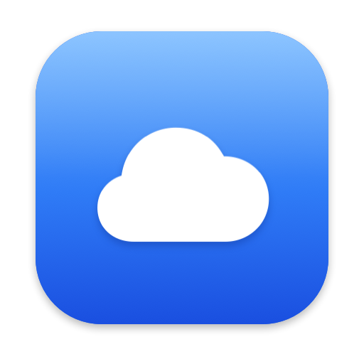
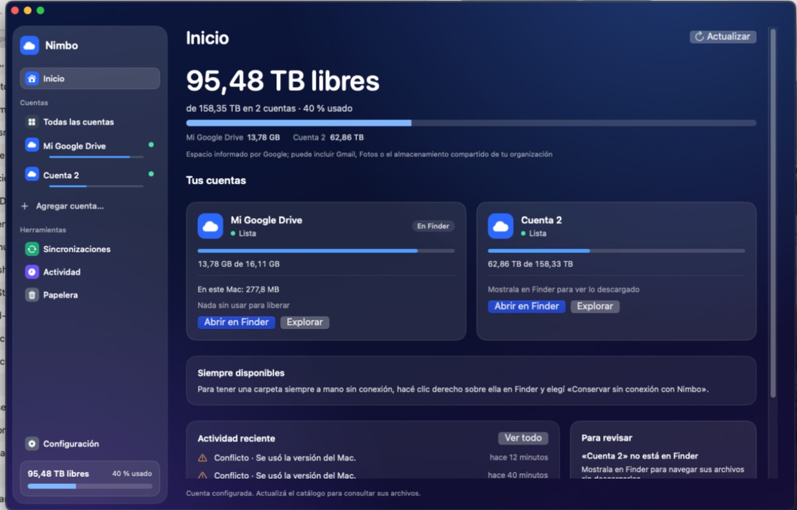
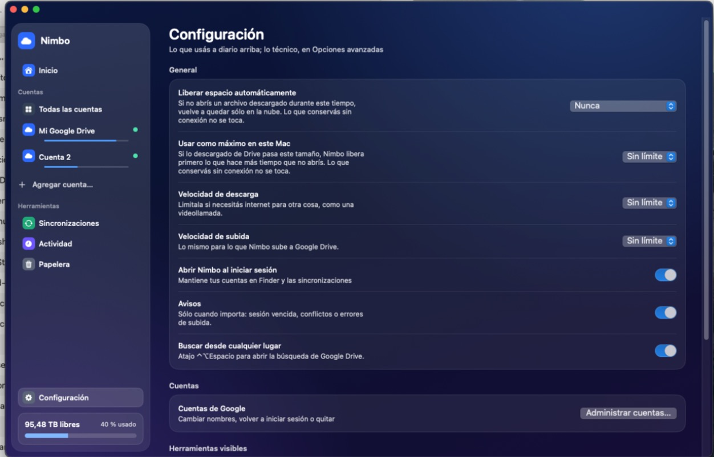
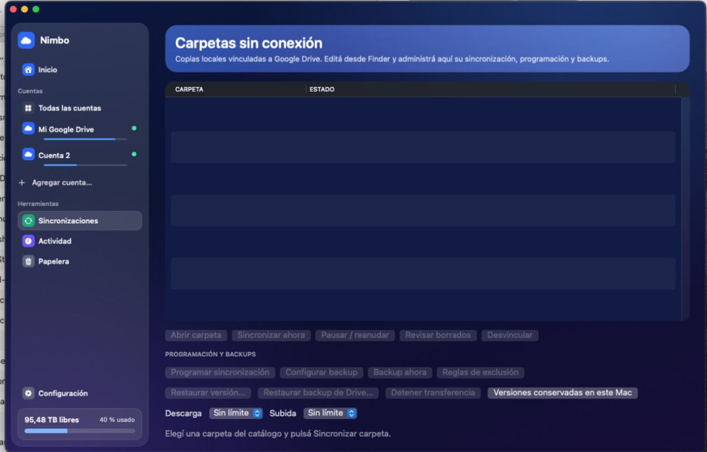

<p align="center">
  
</p>

<h1 align="center">Nimbo</h1>

<p align="center">
  <b>Google Drive en el Finder de tu Mac, bajo demanda.</b><br>
  Ves todos tus archivos sin que ocupen espacio, descargás lo que usás y liberás lo que no.
</p>

<p align="center">
  
  
  
  
  
  
</p>

<p align="center">
  
</p>

---

## Qué es

Nimbo es una app nativa para macOS que lleva Google Drive al Finder igual que lo hace odrive o Google Drive para escritorio, pero simple:

- **Cada cuenta de Google aparece en Finder** como una ubicación propia, con su nombre («Mi Google Drive», «Trabajo»…).
- **Los archivos se ven pero no ocupan espacio** hasta que los abrís o los marcás para tenerlos siempre.
- **Clic derecho para decidir:** sincronizar ahora, conservar sin conexión o liberar espacio.
- **Arrastrás un archivo a la carpeta y se sube.** Si lo editás, se sube la nueva versión sobre el mismo archivo de Drive.
- **Una nubecita en la barra de menús** te dice en palabras qué está pasando.

Todo corre en tu Mac. Nimbo no tiene servidores propios: habla directo con la API de Google Drive usando tu autorización, que se guarda cifrada.

## Funciones

### En Finder
| | |
|---|---|
| **Archivos bajo demanda** | Todo el árbol de Drive visible en Finder sin descargarlo. Al abrir un archivo, se descarga en el momento. |
| **Estados con íconos** | ☁️ sólo en la nube · ✅ disponible en el Mac · ⬆️ subiendo · ⚠️ no se pudo subir. |
| **Clic derecho** | «Sincronizar ahora», «Conservar sin conexión» y «Desincronizar / liberar espacio», también sobre carpetas enteras. Opcional: «Copiar enlace» y «Abrir vista web en Google Drive». |
| **Subir arrastrando** | Copiá o arrastrá a la carpeta de la cuenta y Nimbo lo sube. Las ediciones conservan el mismo ID en Drive. |
| **Miniaturas** | Finder muestra la vista previa de fotos, PDF y videos desde Drive. |
| **Spotlight** | ⌘Espacio encuentra tus archivos de Drive aunque no estén descargados. |
| **Barra lateral** | Cada cuenta como favorito con su nombre y una nube. |

### En la app
| | |
|---|---|
| **Inicio** | Espacio libre total, una tarjeta por cuenta (estado, uso, lo descargado en este Mac), carpetas «Siempre disponibles», actividad reciente y «Para revisar». |
| **Varias cuentas** | Personal, trabajo, clientes… cada una con el nombre que elijas (por ejemplo «🏀 B A S Q U E T») y su propia carpeta en Finder, sin mezclarse. Pueden ser de sólo lectura o con permiso de escritura. |
| **Ícono por cuenta** | Elegí símbolo (nube, básquet, trabajo, casa, cámara…) y color: se usa en la carpeta de Finder y en Nimbo. |
| **Búsqueda** | Por nombre, ruta, fecha y tamaño en todas las cuentas, sin descargar. Atajo global **⌃⌥Espacio**. |
| **Liberar espacio** | Automático por días sin uso, un botón «Liberar lo que no usé en 30 días» y un **límite de espacio** en el Mac (10–250 GB). Nunca toca lo que conservás sin conexión. |
| **Pausar** | Desde el menú: 1 hora, 3 horas o hasta mañana. Finder sigue mostrando todo; las transferencias esperan. |
| **Conflictos** | Si un archivo se editó en el Mac y en Drive a la vez, Nimbo guarda las dos versiones y te deja elegir: «Usar la del Mac» o «Dejar la de Drive». |
| **Sincronizaciones** | Vincula una carpeta de tu Mac (incluso en un disco externo) con una de Drive para tenerlas siempre iguales, con revisión de borrados y copias de conflicto. |
| **Archivos divididos** | Opcional: los archivos muy grandes se suben en partes (100 MB – 2 GB). Si se corta internet, sigue desde la última parte. En el Mac se ven como un solo archivo. |
| **Backups** | Copias programadas a Drive, con retención y cifrado opcional. |
| **Avisos discretos** | Sólo lo importante: sesión vencida, conflictos y errores de subida. |

<p align="center">
  
  
</p>

## Cómo funciona

```
 ┌────────────────────┐   XPC    ┌──────────────────────────────┐   HTTPS   ┌──────────────┐
 │ Nimbo.app          │ ───────▶ │ NimboDrive.appex             │ ────────▶ │ Google Drive │
 │ barra de menús,    │          │ File Provider (replicado)    │           │ API v3 / v2  │
 │ ventana, ajustes   │          │ placeholders, descargas,     │ ◀──────── │              │
 └────────┬───────────┘          │ subidas con diario, íconos   │           └──────────────┘
          │                      └──────────────────────────────┘
          │ procesos             ┌──────────────────────────────┐
          ├────────────────────▶ │ rclone 1.76 (MIT)            │  Sincronizaciones, backups,
          │                      └──────────────────────────────┘  catálogo de búsqueda
          │                      ┌──────────────────────────────┐
          └────────────────────▶ │ NimboActions.appex           │  Copiar enlace / vista web
                                 │ NimboFinderHelper (FinderSync)│ (opcionales)
                                 └──────────────────────────────┘
```

- **File Provider replicado** (`NSFileProviderReplicatedExtension`): macOS crea la carpeta en `~/Library/CloudStorage`, guarda placeholders sin contenido y pide los bytes a Nimbo al abrir. Los estados se muestran con decoraciones propias.
- **Escrituras seguras:** cada subida tiene un diario en disco con IDs preasignados y ETag; si algo se corta, se retoma sin duplicar archivos en Drive.
- **Sincronizaciones:** `rclone bisync` para los archivos comunes y un coordinador propio para los documentos divididos, que nunca pasan por bisync.
- **Credenciales:** la autorización OAuth se guarda cifrada (AES-GCM) y, opcionalmente, protegida con el Llavero de macOS. El archivo en texto plano sólo existe mientras el proceso que lo necesita está abierto.

Más detalle en [docs/ARQUITECTURA.md](docs/ARQUITECTURA.md).

## Tecnologías

- **Swift 5 + AppKit**, sin Xcode: se compila con `swiftc` desde un script.
- **FileProvider**, **FileProviderUI** y **FinderSync** para la integración con Finder.
- **CoreSpotlight**, **UserNotifications**, **Carbon** (atajo global) y **CryptoKit** (MD5, SHA-256, AES-GCM).
- **Google Drive API** (v3 para lectura, v2 para escritura condicional con ETag) vía `URLSession`.
- **[rclone](https://rclone.org) 1.76.0** (MIT) para sincronizaciones, backups y el catálogo.

## Requisitos

- macOS 13 Ventura o posterior, Mac **Intel** (x86_64). Para Apple Silicon hay que compilar con `-target arm64-apple-macosx13.0` y el rclone `osx-arm64`.
- Command Line Tools de Xcode (`xcode-select --install`).
- Un cliente OAuth de Google de tipo «Aplicación de escritorio» con la Google Drive API habilitada. La guía está en la app y en [CONECTAR_GOOGLE_DRIVE.html](CONECTAR_GOOGLE_DRIVE.html).

## Instalar

Paso a paso, incluido cómo pasarlo a otro Mac: **[docs/INSTALAR.md](docs/INSTALAR.md)**.

Compilar desde el código:

```bash
./scripts/fetch-rclone.sh        # descarga rclone 1.76.0 y verifica su SHA-256
zsh source/build.sh              # genera Nimbo.app firmado ad hoc
ditto Nimbo.app ~/Applications/Nimbo.app
open ~/Applications/Nimbo.app
```

## Primer uso

1. Abrí Nimbo: aparece la nubecita en la barra de menús.
2. **Agregar una cuenta de Google…** → nombre para reconocerla → Google en el navegador → Permitir.
3. La cuenta aparece en la barra lateral de Finder. Navegá, abrí lo que necesites y usá el clic derecho para conservar o liberar.

## Estructura del repositorio

```
source/            Código de la app y de las extensiones (Swift, C), íconos y build.sh
source/BadgeAssets Íconos de estado de Finder y su generador
Tests/             Pruebas unitarias, de integración y sondas contra Drive real
scripts/           fetch-rclone.sh
docs/              Instalación, arquitectura, capturas
```

## Pruebas

Las pruebas son ejecutables independientes (sin XCTest). Por ejemplo, la sincronización de documentos divididos con un Drive simulado:

```bash
cd source && xcrun swiftc -parse-as-library CloudCore.swift DriveAPI.swift SyncSettings.swift SyncFilters.swift \
  SecureLocalStore.swift SecureConfig.swift ActivityLog.swift TransferCenter.swift CloudThumbnails.swift \
  SpotlightReconciler.swift SpotlightIndexer.swift SyncFolderPlan.swift SyncCore.swift SyncSplit.swift \
  DriveWriteAPI.swift DriveSplitUpload.swift ../Tests/SyncSplitTests.swift \
  -framework Security -framework AppKit -framework CoreSpotlight -o /tmp/sync-split-tests && /tmp/sync-split-tests
```

Las sondas `*Probe.swift` y `*Smoke.swift` usan una cuenta real y archivos sintéticos; nunca borran datos del usuario.

## Privacidad

- Nimbo no envía datos a ningún servidor que no sea Google.
- Los tokens se guardan cifrados en `~/Library/Application Support/Nimbo` y en el contenedor de la extensión.
- Las búsquedas y Spotlight usan sólo nombres, rutas, fechas y tamaños.
- Los borrados van a la papelera de Google Drive, no se eliminan para siempre.

## Limitaciones conocidas

- Firmado ad hoc, sin notarización de Apple: la primera vez hay que abrirlo con clic derecho → Abrir (ver la guía de instalación).
- Sólo Google Drive. Los Documentos, Hojas y Presentaciones de Google se abren en el navegador.
- Las versiones anteriores de un archivo dividido siguen ocupando espacio en Drive después de editarlo.
- macOS arma el nombre de cada ubicación como «Nimbo - <nombre de la cuenta>» y no permite cambiar el ícono de la barra lateral para servicios de tipo File Provider.

## Créditos

- [rclone](https://rclone.org), MIT — © Nick Craig-Wood. Licencia incluida en [RCLONE-LICENSE.txt](RCLONE-LICENSE.txt).
- El comportamiento en Finder se inspira en odrive y la dirección visual en [Nimbus](https://github.com/CasaVargas/Nimbus). Nimbo no copia código, recursos ni marcas de ninguno de los dos.

## Licencia

Pendiente de definir por el autor.

## Nombre de cada cuenta en la barra lateral de Finder

En macOS 27, Finder ignora el nombre que Nimbo pasa al añadir un favorito y muestra la carpeta de la cuenta como «Nimbo» o «Nimbo - …». El truco: el favorito apunta a un **enlace simbólico con el nombre de la cuenta** (`~/Library/Application Support/Nimbo/Sidebar/<nombre>` → `~/Library/CloudStorage/Nimbo-…`), y Finder muestra el nombre del enlace. Funciona también en macOS 14.

Nimbo lo hace solo al conectar cada cuenta (`NimboFinderIcon.addToSidebar`). Para aplicarlo a mano en un Mac con una versión anterior:

```bash
zsh scripts/finder-sidebar-names.sh
```
